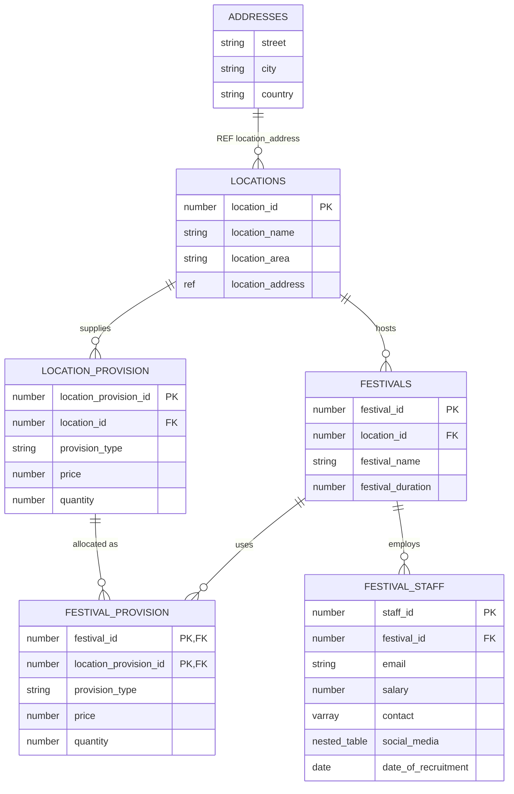

# Festival Management Database (Oracle PL/SQL)

An Oracle database for organising festivals: venues, the supplies each venue provides, festival staff and their contact details. It goes beyond plain tables to use Oracle's **object-relational** features, with a full set of PL/SQL procedures, functions, cursors, a package and triggers on top.

Built as a university database module project (2020). In 2026 I fixed two trigger bugs and made the scripts runnable anywhere.

## Data model



## What it demonstrates

**Object-relational design** (`create_5.sql`)
- User-defined object types: `address_type`, `contact_type`, `social_media_type`
- An **object table** (`addresses OF address_type`) referenced through a scoped `REF`
- A **VARRAY** of contact numbers and a **nested table** of social media accounts stored inside `festival_staff`

**Constraints and sequences** (`alter_5.sql`, `seq_5.sql`)
- Primary keys, including a composite key on `festival_provision`, foreign keys, and sequences for generated IDs

**PL/SQL**
- Parameterised procedures and functions using `%TYPE` anchoring (`functionsandprocedures_5.sql`)
- Implicit and explicit cursors (`cursor_5.sql`), records and `%ROWTYPE` (`records_5.sql`)
- A package with a public function and procedure (`package_5.sql`)
- Anonymous blocks (`unnamedblock_5.sql`)

**Triggers** (`triggers_5.sql`)
- Validation: email format, salary cap (rejects salaries above 50,000), no recruitment dates in the future
- Auditing: logs which user inserted, updated or deleted festivals, and before/after salary changes
- Schema-level `AFTER LOGON` / `BEFORE LOGOFF` triggers recording sessions in an audit table

**Queries** (`queriesDB_5.sql`): joins, subqueries, aggregates and queries over the object types and collections.

## Running it

Tested on **Oracle Database 23ai Free**. The easiest way to get one is Docker:

```sh
docker run -d --name oracle -p 1521:1521 \
  -e ORACLE_PASSWORD=secret -e APP_USER=five -e APP_USER_PASSWORD=five \
  -v "$PWD":/work gvenzl/oracle-free:23-slim-faststart

# when the logs show "DATABASE IS READY TO USE!"
docker exec -it oracle bash -c "cd /work && sqlplus five/five@FREEPDB1 @run.sql"
```

`run.sql` runs every script in order. A few scripts are interactive and prompt for values (for example `&location_id` and `&festival_name`). The optional test scripts and `drop_5.sql` (removes everything) are listed at the bottom of `run.sql`.

## Fixes made in 2026
- `trig_salary` checked `salary < 50000`, so it rejected every salary *under* the cap. It now rejects salaries above it, as its error message intended.
- The `AFTER LOGON` trigger's `/` terminator shared a line with `SHOW ERRORS`, which SQL\*Plus doesn't recognise.
- `run.sql` pointed at `.txt` files under a Windows desktop path; it now uses relative `@@` paths.
