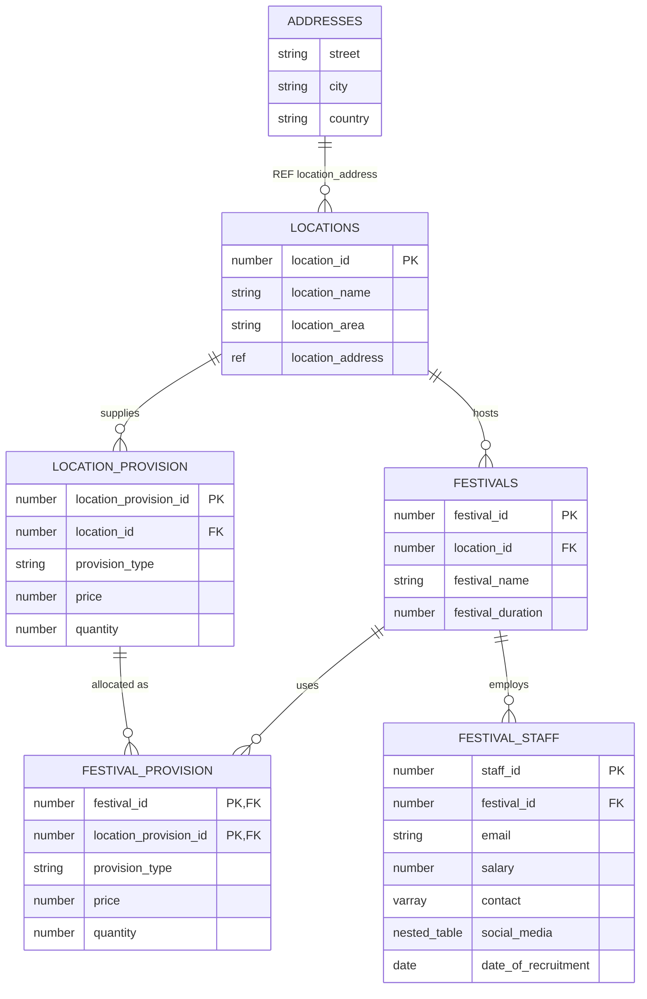

# Festival Management Database (Oracle PL/SQL)

An Oracle database for organising festivals. It stores venues, what each venue can supply, and festival staff with their contact details. I made it for a database module at university in 2020. The module was about Oracle's object-relational features, so it uses object types and collections rather than only plain tables, plus a fair amount of PL/SQL.

In 2026 I fixed two bugs in the triggers and changed the scripts so they run on any machine.

## Data model



## What's in the scripts

| File | Contents |
| --- | --- |
| `create_5.sql` | Object types (`address_type`, `contact_type`, `social_media_type`), an object table of addresses referenced with a scoped `REF`, and `festival_staff` with a VARRAY of phone numbers and a nested table of social media accounts |
| `alter_5.sql`, `seq_5.sql` | Primary and foreign keys (`festival_provision` has a composite key) and sequences for IDs |
| `functionsandprocedures_5.sql` | Procedures and functions with parameters, using `%TYPE` |
| `cursor_5.sql`, `records_5.sql` | Implicit and explicit cursors, records, `%ROWTYPE` |
| `package_5.sql` | A package with a public function and procedure |
| `unnamedblock_5.sql` | Anonymous blocks |
| `triggers_5.sql` | Checks on email format, a salary cap of 50,000 and recruitment dates not in the future; audit logs for changes to festivals and salaries; `AFTER LOGON` / `BEFORE LOGOFF` triggers that record sessions |
| `queriesDB_5.sql` | Joins, subqueries, aggregates, and queries over the object types and collections |

## Running it

I tested it on Oracle Database 23ai Free. The quickest way to get one is with Docker:

```sh
docker run -d --name oracle -p 1521:1521 \
  -e ORACLE_PASSWORD=secret -e APP_USER=five -e APP_USER_PASSWORD=five \
  -v "$PWD":/work gvenzl/oracle-free:23-slim-faststart

# when the logs show "DATABASE IS READY TO USE!"
docker exec -it oracle bash -c "cd /work && sqlplus five/five@FREEPDB1 @run.sql"
```

`run.sql` runs every script in order. Some of them ask you to type in values, like `&location_id` and `&festival_name`. The test scripts and `drop_5.sql`, which deletes everything, are listed at the bottom of `run.sql` if you want them.

## Fixed in 2026
- `trig_salary` checked `salary < 50000`, so it blocked every salary *under* the cap instead of over it. The error message said what it was meant to do, so I changed the check to match.
- The `/` at the end of the `AFTER LOGON` trigger was on the same line as `SHOW ERRORS`. SQL\*Plus doesn't accept that.
- `run.sql` pointed at `.txt` files on my old Windows desktop. It now uses relative `@@` paths.
